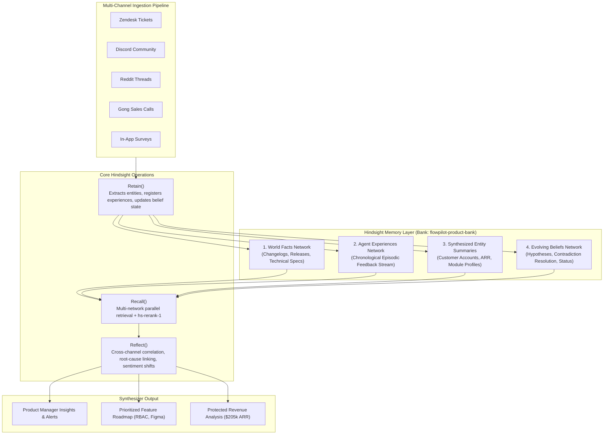

# Architecture & Memory Layer Specification
## User Feedback Synthesizer | HackwithHyderabad 3.0

The **User Feedback Synthesizer** is an autonomous product intelligence agent built on top of **Hindsight**, the open-source agent memory architecture developed by Vectorize.

---

## 1. The Core Problem: Why Traditional Systems Fail

Modern product teams ingest asynchronous user feedback from 5+ disconnected channels:
- Customer Support (Zendesk, Intercom)
- Community Channels (Discord, Slack)
- Public Discourse (Reddit, X, App Stores)
- Enterprise Sales & Customer Success (Gong, Zoom transcripts)
- In-Product Feedback (NPS, CSAT, bug report modals)

### The Failure of Stateless RAG & Chatbots
1. **Temporal Blindness:** Conventional vector databases chunk text and return top-$k$ semantic cosine similarity matches. They have no concept of calendar progression. When a PM asks *"Why is churn escalating this week?"*, standard RAG cannot distinguish between an issue from yesterday and an issue from 3 months ago.
2. **Channel Silos:** A bug report on Discord about high GPU usage is treated as isolated from an enterprise Gong call warning of a paused $85,000 POC, even though both stem from the same software commit.
3. **No Dynamic Mental Models:** Standard LLMs cannot maintain or update evolving hypotheses. When a fix is deployed, a stateless chatbot continues to regurgitate old complaints because the semantic similarity remains high.

---

## 2. The Hindsight Memory Architecture

Hindsight treats memory not as a static vector bucket, but as a **structured reasoning substrate** divided into **4 Logical Memory Networks**:

---

### The 4 Logical Memory Networks Explained

#### 1. World Facts (`world_facts`)
- Stores verified, objective ground-truth about the product, including changelogs, architecture blueprints, SLA agreements, and feature flags.
- **Example in FlowPilot:**
  - `fact_rel_v2_4_0`: Release v2.4.0 (Oct 10) shipped WebWorker async rendering for canvas.
  - `fact_rel_v2_4_1`: Release v2.4.1 (Oct 16) shortened Okta OAuth token renewal check to 45 minutes.
  - `fact_rel_v2_4_2`: Release v2.4.2 (Oct 24) introduced distributed WebLock mutex and GPU buffer deallocation.

#### 2. Agent Experiences (`agent_experiences`)
- Chronological, episodic memory of all raw feedback items, user reports, and prior conversations with PMs.
- Includes timestamps, channel metadata, author role, raw content, and sentiment scores.

#### 3. Synthesized Entity Summaries (`entity_summaries`)
- Dynamic profiles for critical accounts and product modules that evolve over time.
- **Key Accounts Tracked:**
  - `acc_acme_corp`: Acme Global | Enterprise Tier 1 | **$120,000 ARR** | 350 seats | Okta SSO.
  - `acc_finovate`: Finovate Systems | Enterprise Tier 2 | **$85,000 ARR** | 180 seats | Azure SSO.
  - `acc_hyperscale`: HyperScale Labs | Growth Tier | **$24,000 ARR** | 45 seats | Design Sprints.
- **Product Modules Tracked:** `module_canvas`, `module_auth_sso`, `module_export`, `module_rbac`.

#### 4. Evolving Beliefs (`evolving_beliefs`)
- Dynamic mental models that allow the agent to update conclusions, resolve contradictions, and transition hypotheses.
- **Belief Lifecycle in Demo:**
  1. *Belief 1 (Oct 10):* "Canvas WebWorker engine is fast and stable for large-scale diagrams." (Active, Conf: 0.85).
  2. *Belief 2 (Oct 13):* Supersedes Belief 1: "v2.4 introduces WebGL GPU buffer memory leak for diagrams >300 nodes." (Active, Conf: 0.92).
  3. *Belief 3 (Oct 17):* "v2.4.1 OAuth refresh timer (45m) lacks mutex locks across multi-tab sessions, causing catastrophic session revocations." (Active, Conf: 0.98).
  4. *Belief 4 (Oct 24):* Supersedes Beliefs 2 & 3: "v2.4.2 patch stabilized both memory deallocation and WebLock SSO mutex, restoring 100% session persistence." (Active, Conf: 0.96).

---

## 3. The Multi-Dimensional Reranking Algorithm (`hs-rerank-1`)

Retrieval in Hindsight is not raw cosine similarity. The `HindsightReranker` balances 4 dimensions:

$$\text{FinalScore} = (w_{\text{sem}} \cdot S_{\text{sem}}) + (w_{\text{key}} \cdot S_{\text{key}}) + (w_{\text{temp}} \cdot S_{\text{temp}}) + (w_{\text{ent}} \cdot S_{\text{ent}})$$

Where:
- $S_{\text{sem}}$: Semantic relevance score.
- $S_{\text{key}}$: Token overlap on technical terminology (`sso`, `weblock`, `memory leak`).
- $S_{\text{temp}}$: Exponential temporal decay relative to reference timestamp:
  $$S_{\text{temp}} = e^{-\frac{\ln(2)}{\text{HalfLifeDays}} \cdot \Delta t}$$
- $S_{\text{ent}}$: Entity weight calculated from account ARR, enterprise tier, and ticket severity ($P0 / \text{Urgent}$).

---

## 4. Head-to-Head Comparison: Before vs After

| Feature / Capability | Stateless Chatbot / Standard RAG (Before) | Hindsight Synthesizer Agent (After) |
|---|---|---|
| **Temporal Progression** | ❌ Blind: Treats 3-week-old data the same as today's data | ✅ Chronological: Tracks 4-week timeline (Baseline → Regression → Recovery) |
| **Cross-Channel Reasoning** | ❌ Siloed: Treats Discord, Zendesk, and Gong as isolated snippets | ✅ Unified: Connects Discord whispers to Zendesk P0 escalations 3 days early |
| **Product Change Linkage** | ❌ None: Completely unaware of code commits or release versions | ✅ Grounded: Links auth dropouts directly to v2.4.1 token refresh commit |
| **Revenue & Account Awareness** | ❌ Flat: Treats free tier users and $120k ARR accounts identically | ✅ High-Signal: Directly flags $205,000 ARR at risk across Acme and Finovate |
| **Contradiction Resolution** | ❌ Hallucinates: Retains obsolete complaints after bugs are patched | ✅ Evolving Beliefs: Transitions status from crisis to resolved upon v2.4.2 |
| **Long-Term Conversational Memory** | ❌ Amnesic: Forgets previous conversations between turns | ✅ Retentive: Recalls context, decisions, and customer commitments across weeks |

---

## 5. Extensibility & Portability

The agent implements a polymorphic client adapter (`HindsightMemoryClient`):
- **Embedded Mode (Default):** Runs high-fidelity in-memory and disk-persisted Hindsight 4-network engine with zero external dependencies. Ideal for hackathon demos, local development, and offline evaluation.
- **Server Mode:** Seamlessly connects to a live Hindsight daemon (`ghcr.io/vectorize-io/hindsight`) or Hindsight Cloud via standard REST / OpenAPI endpoints.

