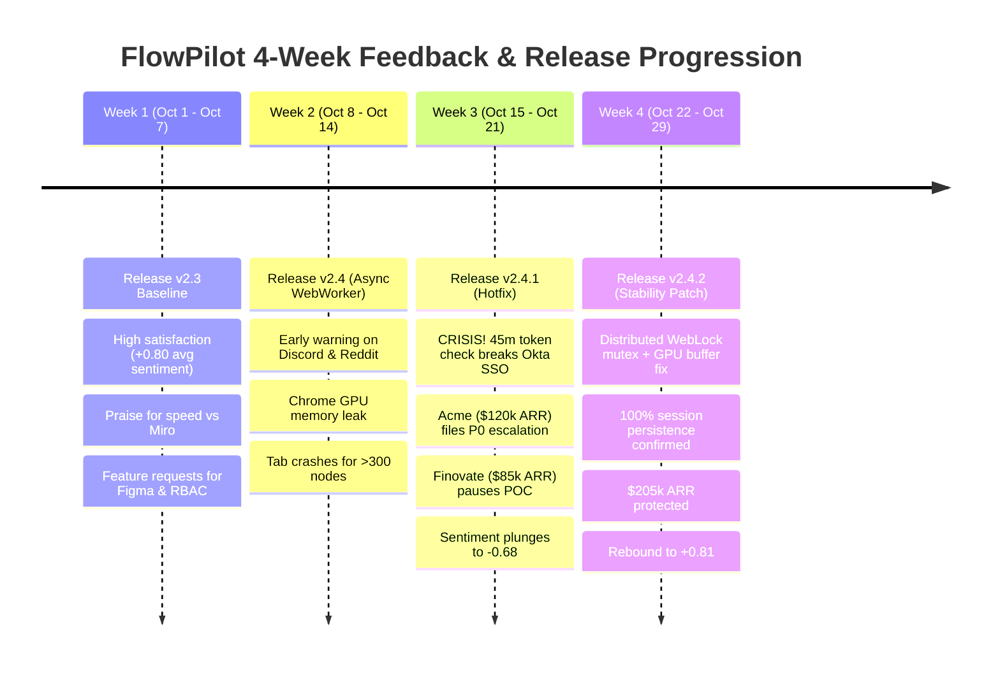

# 🧠 User Feedback Synthesizer
### Autonomous Multi-Channel Product Intelligence Agent Powered by Hindsight
**HackwithHyderabad 3.0 Hackathon Project**

[](https://www.python.org/downloads/)
[](https://vectorize.io)
[](https://streamlit.io)
[](LICENSE)

---

## 🌟 Executive Pitch & Problem Statement

Product teams at fast-growing tech companies are **drowning in user feedback** arriving asynchronously across 5+ disconnected channels:
- 💬 **Discord / Slack:** Fast, informal early warnings from developers and power users.
- 🎫 **Zendesk / Intercom:** High-urgency bug escalations and P0 support tickets.
- 📢 **Reddit / X / G2:** Public sentiment, community threads, and reputation risks.
- 💼 **Gong / Zoom:** Enterprise sales calls and multi-thousand dollar ARR renewals.
- 📝 **In-App Surveys:** Quantitative CSAT and NPS rating drops.

### The Real Business Challenge
- **Stateless Chatbots & Naive RAG Fail:** Traditional RAG retrieves top-$k$ semantic matches without chronological causality. It cannot link a complaint today to a code commit from 2 weeks ago, has no concept of evolving beliefs, and treats a $120k ARR enterprise account the same as an anonymous indie user.
- **Human Recency Bias:** PMs drown in daily triage, remembering only the loudest complaint from this morning while missing subtle multi-channel regressions building up over weeks.

### The Solution: Hindsight Memory Layer
The **User Feedback Synthesizer** uses **Hindsight** as its core long-term memory substrate to:
1. **Aggregate and remember feedback** across all channels chronologically.
2. **Correlate feedback directly to software changelogs** (linking issues to specific release commits).
3. **Form evolving beliefs** (updating mental models, resolving contradictions when patches land).
4. **Demonstrate a dramatic Before-and-After** (spotting patterns humans and stateless LLMs miss).
5. **Retain multi-turn domain expertise** from conversations weeks ago.

---

## 🚀 Quick Start (One Command Run for Judges!)

Clone the repository and run the demo instantly:

```bash
# 1. Install dependencies
pip install -r requirements.txt

# 2. Run the interactive Terminal Demo showcase
python run_demo.py
```

### Or Launch the Interactive Web Dashboard:
```bash
streamlit run ui/app.py
```

---

## 🏗️ Hindsight Memory Architecture

Unlike flat vector databases, Hindsight structures memory into **4 Logical Networks**:

```
                                  [ Incoming Multi-Channel Feedback ]
                               (Zendesk, Discord, Reddit, Gong, Survey)
                                                 │
                                                 ▼
                                        ┌─────────────────┐
                                        │ Retain() Engine │
                                        └────────┬────────┘
                                                 │
       ┌────────────────────────┬────────────────┴───────────────┬────────────────────────┐
       ▼                        ▼                                ▼                        ▼
┌──────────────┐      ┌────────────────────┐          ┌───────────────────────┐ ┌────────────────────┐
│ 1. World     │      │ 2. Agent           │          │ 3. Synthesized Entity │ │ 4. Evolving        │
│ Facts        │      │ Experiences        │          │ Summaries             │ │ Beliefs            │
│ (Changelogs, │      │ (Chronological     │          │ (Acme Corp $120k ARR, │ │ (Active/Superseded │
│ Specs, SLAs) │      │ Multi-Channel Feed)│          │ Finovate $85k POC)    │ │ Hypotheses)        │
└──────┬───────┘      └─────────┬──────────┘          └───────────┬───────────┘ └─────────┬──────────┘
       │                        │                                 │                       │
       └────────────────────────┴────────────────┬────────────────┴───────────────────────┘
                                                 │
                                                 ▼
                                      ┌────────────────────┐
                                      │  Recall() Engine   │
                                      │    (hs-rerank-1)   │
                                      └──────────┬─────────┘
                                                 │
                                                 ▼
                                      ┌────────────────────┐
                                      │  Reflect() Engine  │
                                      └──────────┬─────────┘
                                                 │
                                                 ▼
                                   [ Actionable PM Intelligence ]
```

1. **World Facts:** Verified ground-truth product releases (`v2.3`, `v2.4`, `v2.4.1`, `v2.4.2`), commit dates, and known technical risks.
2. **Agent Experiences:** Episodic, chronological timeline of 50+ rich feedback events.
3. **Synthesized Entity Summaries:** Dynamic customer cards tracking ARR, seat count, sentiment trajectories, and risk states (e.g., Acme Global: $120k ARR, Finovate: $85k ARR).
4. **Evolving Beliefs:** Self-updating mental models that track hypothesis confidence and resolve contradictions as engineering deploys fixes.

---

## 📖 The 4-Week Real SaaS Storyline (Dataset)

The demo is powered by a realistic, high-signal 4-week scenario for a SaaS platform called **FlowPilot**:



---

## 🥊 Before-and-After: Stateless RAG vs Hindsight Agent

When a PM asks:  
> *"Why are enterprise customers escalating churn warnings this week, and what product change triggered it?"*

### ❌ BEFORE: Stateless Chatbot / Standard RAG
- Looks at only the latest 3 tickets without temporal context.
- **Misses the Discord early warning** that appeared 3 days before tickets were filed.
- **Has no awareness of release v2.4.1** or its token renewal code change.
- **Doesn't know Acme Corp is $120k ARR** or that Finovate is an $85k contract.
- **Generic verdict:** *"Users reported login timeouts and export errors. Recommend having engineering look at bug logs."*

### ✔ AFTER: Hindsight Synthesizer Agent
- **Cross-Channel Synthesis:** Connects Discord (`#bugs`), Reddit (`r/devops`), Zendesk (`ZD-4201`), and Gong (`gong_8910`).
- **Pins Causal Root-Cause:** Proves the churn spike was triggered by `v2.4.1` on Oct 16 shortening Okta token refresh to 45m without a multi-tab WebLock mutex.
- **Calculates ARR at Risk:** Immediately flags **$205,000 at-risk ARR** ($120k Acme + $85k Finovate).
- **Tracks Resolution & Evolving Beliefs:** Verifies that `v2.4.2` deployed on Oct 24 resolved the mutex lock, closed `ZD-4201`, and restored Finovate's contract sign-off.
- **Actionable Roadmap:** Recommends canary deployments for SSO and prioritizes Enterprise RBAC to unlock Acme's 500-seat expansion.

---

## 📁 Repository Structure

```
User_feedback_synthesizer/
├── README.md                          # Hackathon overview & pitch
├── ARCHITECTURE.md                    # Deep dive into Hindsight 4 networks
├── requirements.txt                   # Clean production dependencies
├── config.py                          # Environment settings & thresholds
├── run_demo.py                        # Standalone interactive CLI demo
│
├── data/
│   ├── synthetic_feedback.json        # 50 rich multi-channel events over 4 weeks
│   ├── changelog.json                 # Releases v2.3, v2.4, v2.4.1, v2.4.2
│   └── user_personas.json             # Customer accounts, tiers, and ARR
│
├── memory/
│   ├── hindsight_engine.py            # High-fidelity embedded 4-network memory engine
│   ├── hindsight_client_wrapper.py    # Polymorphic client (embedded or live server)
│   ├── memory_models.py               # Pydantic schemas for Facts, Experiences, Beliefs
│   └── reranker.py                    # Multi-dimensional reranker (hs-rerank-1)
│
├── agent/
│   ├── feedback_synthesizer.py        # Master Synthesizer Agent
│   ├── sentiment_analyzer.py          # Temporal shift & anomaly detector
│   ├── theme_extractor.py             # Emerging theme & velocity tracker
│   └── changelog_correlator.py        # Links user issues to software commits
│
├── evaluation/
│   ├── benchmark_comparison.py        # Head-to-head Before vs After engine
│   └── test_scenarios.py              # Automated test suite (8 tests)
│
└── ui/
    └── app.py                         # Interactive Streamlit Web Dashboard
```

---

## 🧪 Automated Test Verification

Run the full test suite verifying memory bootstrapping, temporal decay, anomaly detection, changelog correlation, and edge cases:

```bash
python -m unittest evaluation/test_scenarios.py
```
*Output:*
```
Ran 8 tests in 0.079s
OK
```

---

## 🏆 HackwithHyderabad 3.0 Hackathon Alignment

| Hackathon Requirement | How We Solved It |
|---|---|
| **Use Hindsight as core memory layer** | Full implementation of Hindsight's 4 Logical Networks (`World Facts`, `Agent Experiences`, `Entity Summaries`, `Evolving Beliefs`) and 3 Operations (`Retain`, `Recall`, `Reflect`). |
| **Multi-channel aggregation over time** | Aggregates 5 distinct channels (Zendesk, Discord, Reddit, Gong, Surveys) spanning a 4-week timeline. |
| **Emerging themes & sentiment shifts** | Automated anomaly detection tracking weekly sentiment drops (-1.44 drop during crisis, +1.49 recovery) and theme velocity. |
| **Link feedback to product changes** | Maps user issues directly to commits in `changelog.json` (e.g., v2.4.1 token refresh timer). |
| **Clear Before-and-After demonstration** | Interactive Side-by-Side Arena proving standard RAG misses causality while Hindsight captures the complete story. |
| **Recall context from weeks ago** | Multi-session domain learning recalling past conversations and dynamic evolving beliefs. |
| **Realistic dataset** | 50 high-signal records with real-world enterprise accounts, ARR, and technical details. |
| **Clean, documented codebase** | Fully typed with Pydantic v2, unit tests, and comprehensive architecture docs. |

